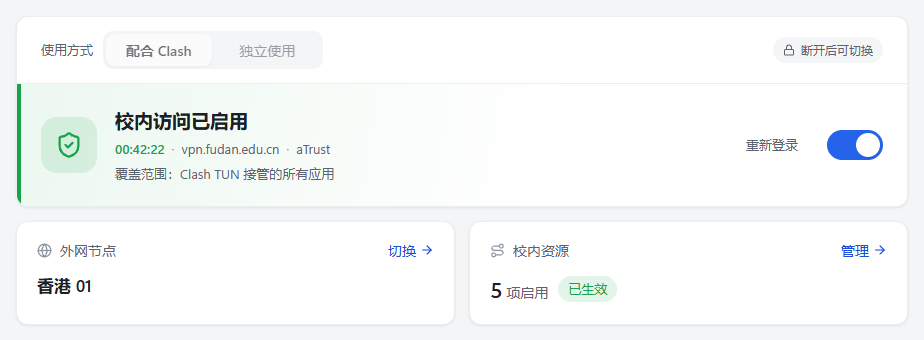
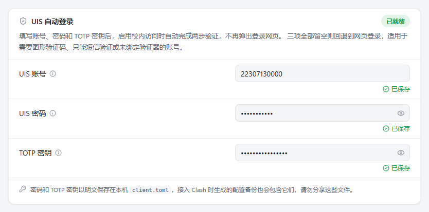
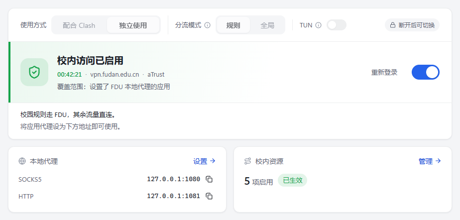

# FDU Bridge

中文 | [English](README_en.md)

复旦大学的桌面校园网工具：在校外打开图书馆、eHall、iCourse 这类只能校内访问的网站，同时不影响你原来的代理和网络。

支持 Windows、macOS 和 Linux，提供图形界面。基于 [ZJU Connect](https://github.com/Mythologyli/zju-connect) 开发。

> [!NOTE]
> 本程序**按原样提供**，作者不保证其正确性或可靠性，使用造成的问题由使用者自行承担。它只是替你连接学校的 aTrust VPN，不会扩大学校授予你的访问权限。

## 它能做什么？

假设你平时用 Clash 上网，想在校外查图书馆数据库。FDU Bridge 会：

1. 用你的 UIS 账号和动态口令自动登录学校 VPN，不用每次打开网页、掏手机输验证码；
2. 只把你指定的校内网站（比如 `library.fudan.edu.cn`、`fdu.edu.cn`）送进学校 VPN；
3. 其他流量照旧走 Clash，你原来的节点、规则、全局／规则模式都不变；
4. 关闭校内访问时，Clash 的外网出口自动恢复。

不用 Clash 也可以：选择「独立使用」，FDU Bridge 自己提供本地代理，或者用 TUN 接管整台电脑的流量。

## 快速开始

### 第 1 步：下载安装

从 [Releases](https://github.com/exdoubled/FDU-Bridge/releases) 下载对应系统的版本：

| 系统 | 下载 | 打开方式 |
| --- | --- | --- |
| Windows | `*-Windows-x64-setup.exe` | 运行安装向导，之后从开始菜单打开 **FDU Connect** |
| macOS | `*-macOS-universal.zip` | 解压后打开 `FDU Connect.app`；首次需在 Finder 中右键选择「打开」 |
| Linux | `*-linux-amd64.tar.gz` | 解压后运行 `fdu-connect-gui`，需要 GTK 4 和 WebKitGTK 6.0 |

Windows 安装包已内置 WebView2，无需另外下载。`*-Windows-x64.zip` 是应用内更新用的精简包，首次安装请用 `setup.exe`。

### 第 2 步：绑定动态口令，拿到 TOTP 密钥

学校的 UIS 登录需要二次验证。FDU Bridge 用 **TOTP 密钥** 自动生成验证码，所以需要先在 UIS 绑定一个动态口令：

1. 打开 [UIS 个人中心 → 账号安全](https://id.fudan.edu.cn/uc/#/pc/userCenter/accountSecurity)，在「动态口令」中按提示绑定。
2. 绑定页面会显示一个二维码和一串 **Base32 密钥**（类似 `JBSWY3DPEHPK3PXP`）。**把这串密钥复制保存下来**，这就是 TOTP 密钥。
3. 同时用手机上的验证器（Microsoft Authenticator、Google Authenticator 等）扫描二维码，完成绑定确认，以后手动登录 UIS 也能用。

> [!IMPORTANT]
> 要填的是**绑定时的密钥**，不是验证器里每 30 秒变化一次的 6 位数字。如果已经绑定过但没保存密钥，需要在 UIS 解绑后重新绑定一次。

### 第 3 步：填写登录信息

打开 FDU Bridge，进入 **设置 → UIS 自动登录**，填写：

| 项目 | 说明 | 示例 |
| --- | --- | --- |
| UIS 账号 | 学号或工号 | `22307130000` |
| UIS 密码 | UIS 统一身份认证密码 | |
| TOTP 密钥 | 第 2 步保存的 Base32 密钥，大小写和空格都能识别 | `JBSWY3DPEHPK3PXP` |

每一项离开输入框后自动保存，卡片右上角显示「已就绪」即可。

> [!TIP]
> 三项全部留空时，会改用原来的网页登录：启用校内访问时弹出 UIS 登录页，在网页里完成验证。需要图形验证码、只能用短信验证、或暂时不想保存密码时可以这样用。只填一部分不行，首页会提示补全。

### 第 4 步：选择使用方式

回到 **首页**，在连接卡顶部选择使用方式：

<b>配合 Clash（已经在用 Clash 时推荐）</b>

1. 先打开你的 Clash 客户端，选好订阅和节点，全局或规则模式都可以。
2. 在 FDU Bridge 的 **设置 → 代理接入** 确认识别到的客户端。同时开着多个客户端时，选定一个并保存。
3. 回到首页，打开 **启用校内访问** 开关，确认首次接入提示。

FDU Bridge 会向 Clash 加入校园规则和一个 `FDU-ROUTER` 节点，之后：

- 切换节点：全局模式在本应用的 **外网节点** 页切换，规则模式在 Clash 里切换；
- 模式和 TUN：在 Clash 里操作，FDU Bridge 会自动跟随；
- 退出：先在首页关闭校内访问，再退出 Clash。关闭时会恢复 Clash 的外网出口；想彻底移除 FDU 写入 Clash 的内容，在 **设置 → 维护** 中操作。

已支持 Clash Verge Rev（含便携版）一键接入，以及 FlClash、Clash Party、Sparkle、Clash Nyanpasu、ClashX.Meta 等 Mihomo 桌面客户端。

<b>独立使用（不用 Clash）</b>

1. 在首页选择 **独立使用**，再选分流模式和是否开启 TUN：

   | 分流模式 | 效果 |
   | --- | --- |
   | 规则 | 校内资源列表中的网站走学校 VPN，其余直连 |
   | 全局 | 所有接入的流量都走学校 VPN（局域网和本机地址除外），只能访问学校允许的目标 |

2. 打开 **启用校内访问**。
3. 让流量进入 FDU Bridge：
   - **不开 TUN**：把浏览器或应用的代理设为首页显示的 SOCKS5／HTTP 地址（点地址旁的按钮可复制）。SOCKS5 建议选择「远程解析域名」（`socks5h`）。
   - **开 TUN**：接管整台电脑的 TCP/UDP 流量，不用设置代理。需要以管理员或 root 身份运行，使用前先关闭其他 VPN 的 TUN。

更多细节见 [独立模式](docs/standalone.md)。

使用方式和分流模式只能在关闭校内访问时切换，选择会自动保存。

### 第 5 步：添加校内网站

进入 **校内资源** 页，添加要走学校 VPN 的网站，逐条勾选启用后点 **保存**：

| 类型 | 写法 | 匹配范围 |
| --- | --- | --- |
| 精确域名 | `library.fudan.edu.cn` | 只匹配这个域名 |
| 域名后缀 | `fdu.edu.cn` | 这个域名及所有子域名 |
| IPv4 网段 | `10.0.0.0/8` 或 `202.120.224.6` | 对应的 IP 地址 |

保存后立即对新连接生效，已打开的连接保持原来的路径。列表可以导入／导出 JSON，方便在电脑之间同步。

## 访问不了时

1. **看首页的覆盖范围**。配合 Clash 且没开 Clash TUN 时，只有走 Clash 代理的应用才会被接管；系统代理里被设为「绕过」的内网地址会直连，需要自己调整绕过列表。
2. **用诊断页检查**。在 **诊断** 页输入出问题的网址，会显示是否命中校内资源规则、登录和隧道状态，以及 DNS／TCP／TLS／HTTP 每一步的结果和处理建议。
3. **需要反馈问题时**，在诊断结果下方点 **预览脱敏报告**，确认内容后复制或导出。报告不包含账号、Token、Cookie、个人路径和自定义的校园主机，可以放心附在 Issue 里。
4. **登录过期**：首页会提示需要重新登录，点 **重新登录** 即可，规则和设置都会保留。网络暂时断开时会自动重连。

> [!WARNING]
> **合规与安全提示**
>
> - 本工具只用于你个人访问学校授权给你的资源，请遵守学校的网络与信息安全规定。不要用全局模式把学校 VPN 当作普通的翻墙或加速出口。
> - 密码和 TOTP 密钥**以明文保存**在本机的 `client.toml` 中，接入 Clash 时生成的配置备份也会包含它们。不要分享这些文件；在公共电脑上使用后，请在设置中清空凭据，并删除下方「配置保存在哪里」所列的目录。
> - TOTP 密钥等同于你的第二个登录因素，泄露后他人可以生成你的验证码。如果怀疑泄露，请在 UIS 解绑并重新绑定动态口令，同时修改密码。

## 常见问题

填了 TOTP 密钥还是提示验证失败？

- 确认填的是绑定时的 Base32 密钥，而不是 6 位验证码。
- 验证码和时间有关，请检查电脑的系统时间是否准确（开启自动同步时间）。
- 认证失败后，程序会停止自动重试，避免账号因多次错误被锁定。改好设置后，在首页点 **重新登录**。

识别不到我的 Clash 客户端？

- 确认 Clash 已经启动，并且开启了外部控制（External Controller）。
- 在 **设置 → 代理接入** 改用 **手动接入**，选择客户端实际使用的完整运行配置（不是只含节点的订阅文件），按需填写控制接口地址和密钥。
- 客户端不支持 Mihomo 控制接口、规则集或专用入口时，改用 **独立使用**。
- 想自己写进订阅的，可以在 **设置 → 代理接入 → 导出扩展** 复制覆写脚本或 YAML 片段。修改 FDU 端口后需要重新导出。

和 Clash TUN 能一起开吗？

可以，也推荐这样做：配合 Clash 时只开 Clash 的 TUN，就能覆盖所有应用。FDU Bridge 自己不会再建虚拟网卡，登录和 VPN 连接会绑定物理网卡，避免被 Clash TUN 再次接管。独立使用时才使用 FDU 自己的 TUN，开之前先关掉其他 VPN 的 TUN。

端口被占用？

配合 Clash 时，启用前会自动换成空闲端口；独立使用时需要在 **设置 → 独立校园代理** 修改监听端口。

开机后自动连接？

在 **设置 → 外观与启动** 打开「开机自启」和「启动后启用校内访问」。配合 Clash 时，FDU Bridge 会等 Clash 和它的控制接口启动后再接入；等待期间可以在首页或托盘取消。

配置保存在哪里？怎么升级、卸载？

- **配置目录**
  - Windows：通常是程序所在目录；该目录不可写时使用 `%APPDATA%\FDU Connect`
  - macOS：`~/Library/Application Support/FDU Connect`
  - Linux：`$XDG_CONFIG_HOME/fdu-connect`，未设置时为 `~/.config/fdu-connect`
- **升级**：可以在应用内检查更新；手动升级时保留上述目录即可保留配置和登录状态。关闭窗口后程序可能仍在托盘运行，替换文件前先退出。
- **换目录**：在新位置的 GUI 中打开 **设置 → 维护 → 选择旧目录**，预览后复制配置、规则和登录状态，旧文件会保留。
- **移除 Clash 接入**：关闭校内访问后，在 **设置 → 维护** 中移除 FDU 写入 Clash 的配置，订阅和个人设置保留。
- **Windows 卸载**：在系统「已安装的应用」中卸载。配置、规则和登录信息不会被删除（默认在 `%LOCALAPPDATA%\Programs\FDU Connect`），卸载向导会列出保留的位置，需要时请手动删除。
- **Windows 启动失败**：会弹出错误提示，日志在 `%LOCALAPPDATA%\FDU Connect\logs\startup.log`。
- **Linux 托盘**：部分桌面不显示托盘图标，因此 Linux 上关闭窗口默认直接退出，可以在设置中改为最小化到托盘。

能用 EasyConnect 或其他学校的 VPN 吗？

图形界面的 Clash 接入和独立分流只支持 aTrust（复旦目前使用的 VPN）。EasyConnect 可以继续使用命令行核心，见 [配置参数](docs/config.md)。**设置 → 高级设置** 可以修改服务器、认证方式、DNS、网卡和端口转发，或导入 TOML 配置；其他网关和复杂认证组合需要自行验证。

---

## 工作原理

> 以下内容面向想了解实现的读者，日常使用不需要阅读。

FDU Bridge 负责 UIS 认证、aTrust 隧道和校内资源的转发；流量从哪里进来，取决于使用方式。

**配合 Clash**：Clash 通过 TUN、系统代理或应用代理接收流量。启用时，GUI 向 Clash 加入 `FDU-ROUTER` 节点、校园规则和一个专用回流入口。Clash Verge Rev 会先备份，再写入订阅扩展；其他客户端通过控制接口加载内存中的覆写，不修改订阅文件，客户端重载后会自动重新接入。GUI 不修改系统代理、绕过列表或 Clash 的 TUN 开关。

| Clash 模式 | 校内资源 | 其他流量 |
| --- | --- | --- |
| 全局 | Clash → FDU Bridge → aTrust 隧道 | Clash → FDU Bridge → Clash 回流入口 → `INTERNET` 所选出口 |
| 规则 | Clash 校园规则 → FDU Bridge → aTrust 隧道 | 沿用 Clash 原有的规则和节点 |

全局模式的回流入口固定使用 `INTERNET`，避免再次进入 `GLOBAL` 形成循环。

**独立使用**：应用代理或 FDU 的 TUN 把流量交给同一个路由器，规则模式与 Clash 模式共用校内资源列表。TUN 模式会拦截发往公网解析器的 DNS 查询，用临时地址保留原始域名，以便按域名分流；发往局域网解析器的查询原样转发。

两种方式下，FDU 都使用用户态网络栈；登录和 VPN 底层连接绑定物理网卡，不会被其他 TUN 再次接管。校内资源在隧道不可用时不会退回直连。

## 更多文档

- [独立模式](docs/standalone.md)：四种组合、DNS 处理和限制
- [配置参数](docs/config.md)：命令行与 TOML 配置项、选择性分流、FDU TUN
- [从源码构建](docs/build.md)：GUI 构建与打包、命令行核心、服务与 Docker
- [开发计划](docs/roadmap.md)

## 致谢

- [Mythologyli/zju-connect](https://github.com/Mythologyli/zju-connect)：本项目的直接上游。
- [AkiraSalvare/fdu-connect](https://github.com/AkiraSalvare/fdu-connect)：复旦适配的参考项目。
- [EasierConnect](https://github.com/lyc8503/EasierConnect)（已停止维护）：ZJU Connect 的基础，作者 [lyc8503](https://github.com/lyc8503)。
- [socks2http](https://github.com/zenhack/socks2http)
-  [NodeSupport](https://github.com/NodeSeekDev/NodeSupport) 赞助了上游项目。

感谢上游及原项目的所有贡献者：

## 许可证

[AGPL-3.0](LICENSE)
