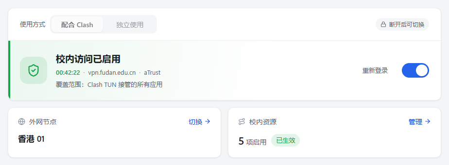
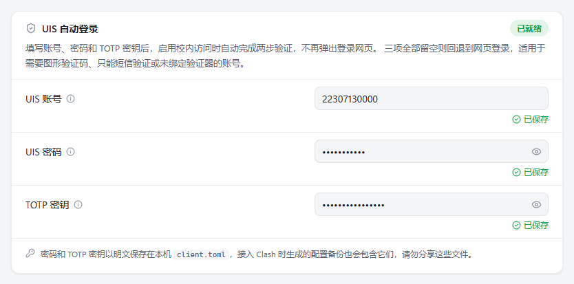
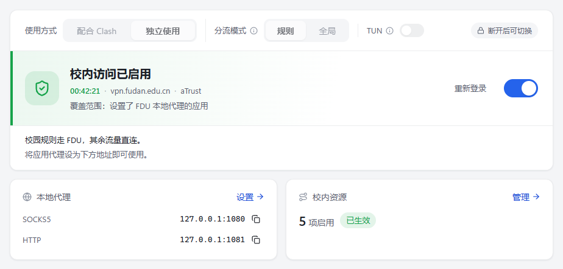

# FDU Bridge

[中文](README.md) | English

A desktop campus-network tool for Fudan University. Open campus-only sites such as the library, eHall and iCourse from off campus, without disturbing your existing proxy or network setup.

Runs on Windows, macOS and Linux with a graphical interface. Built on [ZJU Connect](https://github.com/Mythologyli/zju-connect).

> [!NOTE]
> This program is provided **as is**, without any guarantee of correctness or reliability. You are responsible for any consequences of using it.

## What does it do?

Say you browse through Clash with a virtual network adapter (TUN) enabled. When you try to search a library database from off campus, that setup can conflict with the campus VPN. FDU Bridge will:

1. Sign in to the campus VPN with your UIS account and one-time-password key, so you no longer open a web page and type a code from your phone each time;
2. Send only the campus sites you choose (for example `library.fudan.edu.cn` or `fdu.edu.cn`) through the campus VPN;
3. Leave all other traffic on Clash, keeping your nodes, rules and global/rule mode unchanged;
4. Restore Clash's outside exit when you turn campus access off.

To use FDU Bridge without Clash, choose **Standalone**. It provides its own local proxies or captures the whole computer's traffic with TUN. For specialized setups, you can also use the command-line core.

The interface is currently in Chinese; the English labels below are followed by the Chinese text you will see.

## Quick start

### Step 1: Download and install

Download the build for your system from [Releases](https://github.com/exdoubled/FDU-Bridge/releases):

| System | Download | How to open |
| --- | --- | --- |
| Windows | `*-Windows-x64-setup.exe` | Run the installer, then open **FDU Connect** |
| macOS | `*-macOS-universal.zip` | Unzip and open `FDU Connect.app`; the first time, right-click it in Finder and choose Open |
| Linux | `*-linux-amd64.tar.gz` | Extract and run `fdu-connect-gui`; requires GTK 4 and WebKitGTK 6.0 |

The Windows installer bundles WebView2, so nothing else needs downloading. `*-Windows-x64.zip` is the lightweight package used for in-app updates; use `setup.exe` for the first install.

### Step 2: Set up one-time passwords and save the TOTP key

UIS sign-in requires a second factor. FDU Bridge generates the codes from a **TOTP key**, so you first need to bind a one-time password in UIS:

1. Open [UIS user center → Account security](https://id.fudan.edu.cn/uc/#/pc/userCenter/accountSecurity) and bind a one-time password (动态口令).
2. The binding page shows a QR code and a **Base32 key** (something like `JBSWY3DPEHPK3PXP`). **Copy and keep this key**; it is your TOTP key.

> [!IMPORTANT]
> Enter the **Base32 key shown on the UIS setup page**. The six-digit code in your authenticator changes every 30 seconds and cannot be used in this field.

### Step 3: Enter your sign-in details

Open FDU Bridge and go to **Settings → UIS automatic login (设置 → UIS 自动登录)**:

| Field | Description | Example |
| --- | --- | --- |
| UIS account (UIS 账号) | Student or staff ID | `22307130000` |
| UIS password (UIS 密码) | Your UIS password | |
| TOTP key (TOTP 密钥) | The Base32 key from step 2; case and spaces are ignored | `JBSWY3DPEHPK3PXP` |

Each field saves automatically when it loses focus. The card shows **Ready (已就绪)** once everything is saved.

> [!TIP]
> Leave all three fields empty to use web login. When you enable campus access, the UIS sign-in page opens so you can complete verification. If you fill in only some fields, the Home page prompts you to complete the rest.

### Step 4: Choose how to use it

Back on **Home (首页)**, pick a mode at the top of the connection card:

<b>With Clash (配合 Clash) — recommended if you already use Clash</b>

1. Start your Clash client and pick a subscription and node; global or rule mode both work.
2. In FDU Bridge, confirm the detected client under **Settings → Proxy integration (设置 → 代理接入)**. If several clients are running, select one and save.
3. Back on Home, turn on **Enable campus access (启用校内访问)** and accept the first-use prompt.

FDU Bridge adds campus rules and an `FDU-ROUTER` node to Clash. After that:

- Switch nodes on this app's **Internet nodes (外网节点)** page in global mode, or in Clash in rule mode;
- Change mode and TUN in Clash; FDU Bridge follows automatically;
- To quit, turn off campus access on Home first, then quit Clash. Turning it off restores Clash's outside exit; to remove everything FDU wrote into Clash, use **Settings → Maintenance (设置 → 维护)**.

Clash Verge Rev (including portable installs) connects in one click. FlClash, Clash Party, Sparkle, Clash Nyanpasu, ClashX.Meta and other Mihomo desktop clients are also supported.

<b>Standalone (独立使用) — without Clash</b>

1. On Home, choose **Standalone**, then pick a routing mode and whether to enable TUN:

   | Routing mode | Effect |
   | --- | --- |
   | Rule (规则) | Sites in your campus resource list use the campus VPN; everything else goes direct |
   | Global (全局) | All captured traffic uses the campus VPN (except LAN and local addresses), so only destinations the university allows will work |

2. Turn on **Enable campus access**.
3. Send traffic into FDU Bridge:
   - **Without TUN**: set your browser or app proxy to the SOCKS5/HTTP address shown on Home (use the button next to it to copy). For SOCKS5, enable remote DNS resolution (`socks5h`).
   - **With TUN**: captures the whole computer's TCP/UDP traffic, no proxy settings needed. Run as administrator or root, and turn off other VPNs' TUN first.

See [standalone mode](docs/standalone.md) for details.

The mode and routing choice can only be changed while campus access is off, and are saved automatically.

### Step 5: Add campus sites

On the **Campus resources (校内资源)** page, add the sites that should use the campus VPN, tick each one you want enabled, and click **Save (保存)**:

| Type | Example | Matches |
| --- | --- | --- |
| Exact domain | `library.fudan.edu.cn` | That domain only |
| Domain suffix | `fdu.edu.cn` | The domain and all its subdomains |
| IPv4 subnet | `10.0.0.0/8` or `202.120.224.6` | Those IP addresses |

Saved rules apply to new connections immediately; existing connections keep their route. The list can be imported and exported as JSON to sync between computers.

## When something does not work

1. **Check coverage on Home (覆盖范围).** With Clash and without Clash TUN, only applications that use Clash's proxy are captured. Campus addresses bypassed by your system proxy still connect directly, so adjust the bypass list yourself.
2. **Use the Diagnostics page (诊断).** Enter the URL that fails to see whether it matches a campus rule, the login and tunnel state, and the result of each DNS/TCP/TLS/HTTP step with suggestions.
3. **To report a problem**, click **Preview redacted report (预览脱敏报告)** under the result, review it, then copy or export it. The report excludes account details, tokens, cookies, personal paths and custom campus hosts, so you can attach it directly to an issue.
4. **Expired login:** Home tells you to sign in again; click **Relogin (重新登录)**. Rules and settings are kept. Temporary network drops reconnect automatically.

> [!WARNING]
> **Compliance and security**
>
> - Use this tool only for personal access to resources the university has authorized you to use. Follow the university's network and information-security rules.
> - The password and TOTP key are **stored in plain text** in the local `client.toml`, and in the configuration backups made when connecting to Clash. Do not share these files. After using a shared computer, clear the credentials in Settings and delete the directories listed under "Where is the configuration stored?" below.
> - The TOTP key is your second sign-in factor; anyone who has it can generate your codes. If you suspect it leaked, unbind and rebind the one-time password in UIS and change your password.

## FAQ

I entered the TOTP key but verification still fails

- Make sure you entered the Base32 key from binding, not a six-digit code.
- Codes depend on the clock; check that your system time is correct (enable automatic time sync).
- After a failed sign-in the app stops retrying so your account does not get locked by repeated errors. Fix the settings, then click **Relogin** on Home.

My Clash client is not detected

- Make sure Clash is running with its external controller enabled.
- Under **Settings → Proxy integration**, switch to **Manual (手动接入)** and select the complete runtime configuration the client actually uses (not a node-only subscription), plus the controller address and secret if needed.
- If the client lacks the Mihomo controller API, rule providers or dedicated listeners, use **Standalone**.
- To add it to your subscription yourself, copy the override script or YAML fragment from **Settings → Proxy integration → Export extension (导出扩展)**. Export again after changing FDU's ports.

Can I use it together with Clash TUN?

Yes. FDU Bridge was originally built to work with Clash TUN, and this is the recommended setup. Enable only Clash's TUN to cover every application. FDU Bridge does not create another virtual adapter. It binds its sign-in and VPN connections to the physical network interface so Clash TUN does not capture them again. Use FDU's own TUN only in standalone mode, and turn off other VPNs' TUN first.

A port is already in use

With Clash, free ports are chosen automatically before enabling. In standalone mode, change the listening ports under **Settings → Standalone campus proxy (设置 → 独立校园代理)**.

Connect automatically at startup

Under **Settings → Appearance and startup (设置 → 外观与启动)**, turn on start at login and enable campus access after launch. With Clash, FDU Bridge waits for Clash and its controller before connecting; cancel the wait from Home or the tray.

Where is the configuration stored? How do I upgrade or uninstall?

- **Configuration directory**
  - Windows: normally the program directory; `%APPDATA%\FDU Connect` when that is not writable
  - macOS: `~/Library/Application Support/FDU Connect`
  - Linux: `$XDG_CONFIG_HOME/fdu-connect`, or `~/.config/fdu-connect` when unset
- **Upgrade**: check for updates in the app, or keep the directory above when upgrading manually to keep your configuration and login. Closing the window may leave the app in the tray; quit it before replacing files.
- **Move to a new directory**: in the GUI at the new location, open **Settings → Maintenance → Select old directory**, preview, then copy configuration, rules and login state. The old files are kept.
- **Remove the Clash integration**: with campus access off, remove what FDU wrote into Clash under **Settings → Maintenance**. Subscriptions and personal settings are kept.
- **Uninstall on Windows**: uninstall from the system's Installed apps list. Configuration, rules and login data are not deleted (by default in `%LOCALAPPDATA%\Programs\FDU Connect`); the uninstaller lists what it kept, so delete it manually if needed.
- **Windows fails to start**: an error dialog is shown, and the log is at `%LOCALAPPDATA%\FDU Connect\logs\startup.log`.
- **Linux tray**: some desktops hide tray icons, so on Linux closing the window quits by default; change this in Settings.

Does it work with EasyConnect or other universities' VPNs?

The GUI's Clash integration and standalone routing support aTrust only (the VPN Fudan currently uses). EasyConnect remains available through the command-line core; see the [configuration reference](docs/config_en.md). **Settings → Advanced (设置 → 高级设置)** adjusts the server, authentication, DNS, network interface and port forwarding, or imports a TOML configuration. Other gateways and complex authentication combinations need your own verification.

---

## How it works

> This section is for readers interested in the implementation; you do not need it for everyday use.

FDU Bridge handles UIS authentication, the aTrust tunnel and forwarding of campus resources; where traffic comes from depends on the mode.

**With Clash**: Clash receives traffic through TUN, the system proxy or per-application proxies. When enabled, the GUI adds an `FDU-ROUTER` node, campus rules and a dedicated return listener to Clash. Clash Verge Rev is backed up before its subscription extensions are written; other clients load an in-memory override through their controller without touching subscription files, and reconnect automatically after the client reloads. The GUI does not change the system proxy, bypass list or Clash's TUN switch.

| Clash mode | Campus resources | Other traffic |
| --- | --- | --- |
| Global | Clash → FDU Bridge → aTrust tunnel | Clash → FDU Bridge → Clash return listener → exit selected in `INTERNET` |
| Rule | Clash campus rules → FDU Bridge → aTrust tunnel | Clash's existing rules and nodes |

In global mode, the return listener is pinned to `INTERNET` to avoid looping back through `GLOBAL`.

**Standalone**: application proxies or FDU's TUN feed the same router, and rule mode shares the campus resource list with Clash mode. In TUN mode, DNS queries sent to public resolvers are intercepted and answered with temporary addresses that keep the original domain for routing; queries sent to LAN resolvers are forwarded unchanged.

In both modes FDU uses a userspace network stack, and its login and VPN connections are bound to the physical interface so another TUN does not capture them again. Campus destinations never fall back to a direct connection when the tunnel is unavailable.

## More documentation

- [Standalone mode](docs/standalone.md) (Chinese): the four combinations, DNS handling and limitations
- [Configuration reference](docs/config_en.md): command-line and TOML options, selective routing, FDU TUN
- [Building from source](docs/build_en.md): GUI build and packaging, command-line core, services and Docker
- [Roadmap](docs/roadmap_en.md)

## Acknowledgements

- [Mythologyli/zju-connect](https://github.com/Mythologyli/zju-connect): the direct upstream of this project.
- [AkiraSalvare/fdu-connect](https://github.com/AkiraSalvare/fdu-connect): reference project for the Fudan adaptation.
- [EasierConnect](https://github.com/lyc8503/EasierConnect) (no longer maintained): the foundation of ZJU Connect, by [lyc8503](https://github.com/lyc8503).
- [socks2http](https://github.com/zenhack/socks2http)
-  [NodeSupport](https://github.com/NodeSeekDev/NodeSupport) sponsored the upstream project.

Thanks to all contributors of the upstream and original projects:

## License

[AGPL-3.0](LICENSE)
